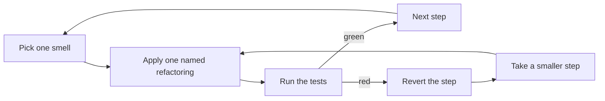

# /refactoring - Change the Structure, Keep the Behaviour

Refactoring changes how code is built without changing what it does, in steps small enough that each one can't go far wrong. This skill follows Martin Fowler's *Refactoring* (2nd edition); [CATALOGUE.md](CATALOGUE.md), beside this file, maps the smells to named refactorings with examples on this stack.

Arguments passed: `$ARGUMENTS`

## 1. Two Hats

At any moment you are wearing one of two hats:

- **Adding function** - new behaviour, a bug fix. Tests are added or changed.
- **Refactoring** - same behaviour, better structure. No test changes what it asserts.

Never both in one step. Say which hat you're wearing, in the session document and to the user, and say when you switch. When you find a bug while refactoring, don't fix it: note it in the session document and fix it later under the other hat, with its own test. A fix slipped into a refactor is a behaviour change no test asked for and no reviewer looks for.

One exception to "no test changes": a test that pinned structure rather than behaviour - it mocks a private helper, asserts a call order, imports a module you're moving. Update it, say so, and check it still asserts the same behaviour. If it asserted nothing else, it was a structure test; the [Testing guide](../../../docs/guides/TESTING-GUIDE.md)'s "Writing a Test That Can Fail" says what to do with it.

## 2. Safety Net First

1. **Run the tests that cover the code**, in Docker through the project's test script - never on the host. They must be green before the first step; a red suite can't tell you a step broke something.
2. **Check they would notice.** For the behaviour you're about to restructure, name the test that goes red if it breaks. If there isn't one, write characterization tests first: call the code as it is and assert what it returns today, odd results included. They are written under the adding-function hat, before refactoring starts.
3. **No feasible tests** - no seam to call through, side effects everywhere: stop and ask. Refactoring blind is a rewrite.

## 3. The Loop

- **One named refactoring per step** - Extract Function, Move Function, Rename Variable - from the catalogue. If you can't name the step, it's probably two steps, or a behaviour change.
- **Run the tests after every step.** A narrow run while iterating, the full suite before you stop - a mechanical change across many files breaks files no hand-picked run includes.
- **A red step is reverted, not debugged.** Undo it and take a smaller one. Debugging forward mixes the hats again.
- **Keep steps small enough that reverting is cheap**: minutes of work, not an hour.

## 4. Preparatory Refactoring

When a feature or fix doesn't fit the code as it is, first refactor until it does, then switch hats and add it: make the change easy, then make the easy change. Two commits, two hats. The refactor goes first and passes on its own, so the feature's diff shows only the feature.

## 5. Larger Moves

Some changes are too big for one sitting, or cross a boundary other code depends on. Keep the system working at every commit:

- **Parallel change** - expand, migrate callers, contract. Add the new shape beside the old one, move callers over one at a time, remove the old shape last.
  - A database schema: the [Database guide](../../../docs/guides/DATABASE-GUIDE.md)'s expand-contract and its backward-compatibility gate own this. The contract step ships in a later release.
  - An API route or response model: clients you don't deploy - the iOS app in people's hands - still use the old shape. The [SDK Generation guide](../../../docs/guides/SDK-GENERATION-GUIDE.md)'s breaking-change check decides.
- **Branch by abstraction** - put an interface in front of the thing being replaced, move callers to the interface, swap the implementation behind it, remove the old one. On this stack the interface is usually an adapter ([API Structure](../../../docs/guides/API-STRUCTURE-GUIDE.md) choice 2) with an in-process fake.
- **Strangler** - route one slice of traffic or one feature at a time to the new code, until the old code has no callers left.

Where an installed guide owns the move - layers, migrations, the generated client - follow the guide; this skill only says how to get there in small steps.

## 6. When Not to Refactor

- **Code nobody needs to change or understand.** Messy code that works and isn't in your way can stay messy.
- **A rewrite is cheaper.** If every step needs a characterization test you can't write, say so and propose the rewrite as its own decision.
- **Generated code.** Change its source - the API routes and models for the OpenAPI spec and clients - and rerun the generator. Never hand-edit the output.
- **Right before a release**, unless the refactor is what unblocks it.
- **Without tests and without a way to add them.** Stop and ask (section 2).

## 7. In the Workflow

- **Session document**: the hat you're wearing, the refactorings done, the bugs found and deferred.
- **Commits**: propose refactoring commits separate from feature commits, prefixed `refactor:`, and ask before committing.
- **Tests**: a refactor adds no behaviour tests - characterization tests come before it, under the other hat.
- **Design docs**: update a component's design doc only when its structure, as the doc describes it, changed. No product rule changes.
- **`05_DESIGN-DECISIONS.md`**: only when the refactor chose between real alternatives someone will want to reverse - a new layer, a new boundary.
- **Afterwards**: run `/simplify`, then `/code-review` and `/review-guides` on the diff. Each can hand a smell back here.
- **Jira**: in Maintenance mode, a standalone refactor needs its own ticket; a preparatory refactor rides on the ticket of the feature it prepares.
