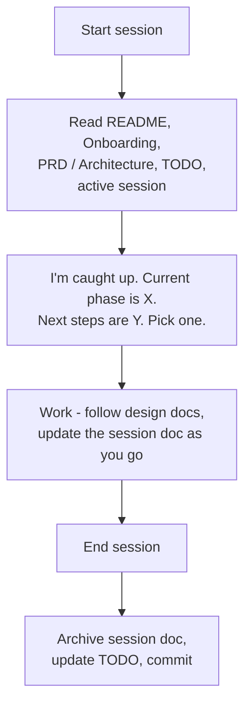

# From Chaos to Flow: Spec-Driven Development with AI Assistants

## The Problem

AI coding assistants are powerful but chaotic. Without structure, they:

- **Lose context between sessions** — You re-explain your project every conversation
- **Are excessively verbose** — They generate walls of documentation nobody asked for
- **Build things you didn't request** — They "helpfully" add features, files, and abstractions
- **Make decisions without consulting you** — Architecture choices happen mid-implementation
- **Let the codebase spiral out of control** — Before you know it, you have 50 files you don't recognize

The result: you spend more time managing the AI than building your product.

## The Insight

The solution isn't better prompts—it's **structured documentation that acts as guardrails**.

When every phase has a design document, every session has a task list, and every document has instructions for how the AI should interact with it, the AI stops improvising and starts *following instructions*.

### The Architect Mindset

This system requires a shift in how you work. **You are no longer the developer—you are the architect.** The AI is your developer.

Your job is to:
- Think big picture: infrastructure, system architecture, software patterns
- Make design decisions *before* code gets written
- Provide clear, unambiguous instructions on what to build
- Review and guide, not implement line-by-line

**Not having an architect mindset will guarantee failure.** If you dive into implementation details without establishing the foundation—infrastructure, architecture, design patterns, performance considerations, maintainability—the AI will fill those gaps with its own decisions. And you won't like all of them.

### What Changes With This System

- **The AI stays focused** — It works within defined boundaries instead of running loose
- **Instant resume** — Pick up any session with one command, no re-explaining
- **Documentation stays current** — It's part of the workflow, not an afterthought
- **Design-first development** — Decisions happen *before* code, captured permanently
- **Coherent codebase** — Everything follows documented patterns

In short: you tame the chaos. The AI becomes a reliable collaborator instead of a loose cannon.

It works with Claude Code and Cursor: the rules live in `AGENTS.md`, which both read, and the commands and hooks are installed for both.

## The System in 60 Seconds

**Document Tiers:**

| Tier | Documents | Purpose |
|------|-----------|---------|
| **Core** | README, AGENTS.md, Onboarding, PRD, Architecture, TODO, Infrastructure, Design Decisions | Never archive. The decision log is reset at the end of a design phase. |
| **Reference** | Troubleshooting, Guides, Design docs, the product spec | Stable knowledge. Rarely changes. |
| **Working** | Session docs in `docs/sessions/` | Active work. Archive when done. |
| **Archive** | `docs/archive/`, `docs/archive/sessions/` | Historical record of completed work. |

**The Workflow:**



**Key Commands** (Claude Code names; in Cursor use a dash instead of the colon, e.g. `/documentation-system-catch-up`):

- `/documentation-system:catch-up` — AI reads all docs, reports current state, ready to work
- `/documentation-system:status-update` — Update the session doc and TODO; archive the session when done
- `/documentation-system:reminders` — Refresh rules mid-session (for long conversations)
- `/documentation-system:init` — Check the setup and walk through fixing what's missing (docs, hooks, permissions, Jira, testing)
- `/documentation-system:audit` — Check the docs for consistency, broken links, verbosity and overused emphasis
- `/jira` — Look up, create and move Jira tickets (the same name in both tools)
- `/helpme` — In Claude Code, a tour of the system and this project's commands, or an answer to a question about them, citing the file that owns it

## Getting Started

### Install

You need the GitHub CLI (`gh`) and access to the private template repo.

```bash
gh extension install agarcian/gh-docsys   # once per machine
gh docsys install                         # from the root of your repo
```

If the extension install fails with `failed to run git`, your `gh` is cloning over SSH with a key that can't see private repos - common with several GitHub accounts on one machine. Install over HTTPS once: `gh config set git_protocol https -h github.com`, install, then set it back to `ssh`. Upgrades keep working.

Then review the changes and commit them through a PR. Only one person installs: everyone else gets the system by pulling. `gh docsys list` shows the optional guides (testing, AWS tagging, ...), and `gh docsys install --guides testing` adds them.

### Start From a Stack

A **stack** is a set of guides for one technology stack, installed together: `gh docsys install --stacks python-angular-aws`. Its foundation guides - auth, database, observability, deployment and more - each give their choices with the reasons and the traps a production project hit, and an implementation pack with tested starter code that the `apply-guide` skill applies. Built in the order the stack guide gives, they produce a working foundation - sign-in, users, logs, tests, deployment - before any product code. `gh docsys list` shows the stacks and their guides.

### Set Up

Open your AI assistant and run `/documentation-system:init`. It checks what's in place and walks you through the rest, one step at a time, asking before it changes anything:

- **The core docs** — the PRD (what you're building and why), Architecture (how it's built) and Infrastructure (environments, deployment)
- **Project rules** in `AGENTS.md` — your stack, cloud accounts and conventions, which the AI loads every session
- **Jira** — your project key and workflow, so the AI can read and update tickets
- **Hooks, permissions and testing** — the guardrails that keep the AI inside the system

**Think like an architect here.** These documents define the constraints your AI developer will work within. Vague requirements produce vague implementations.

### Stand Up the Foundation

With a stack installed, `/stand-up` builds the foundation in one pass. It asks each fact once - the app's name, environments, accounts, domains, and for each optional part (AI, the public site, paid plans, webhooks...) whether it's needed **Now**, **Later** or **Never** - then assembles the stack's tested starter code without what you left out, adapts it, verifies it in Docker, deploys dev through CI, and writes the roadmap: what's built, what comes next, and each Later item with the trigger that brings it in. `/apply-guide add <part>` brings one in when its trigger comes.

A few things are a person's to do first - a domain, the company's directory with two-step verification, the AWS account and Identity Center, GitHub, Jira. The stand-up's question list, `.claude/skills/apply-guide/STANDUP.md`, lists them in order under "Before the Stand-up".

### Stay Current

`gh docsys update` brings in new versions of the system. It never overwrites your project's docs, and if you edited one of the system's own files, the new version lands next to it as a `.docsys-new` file for you to merge. `gh docsys update --guides <name>` or `--stacks <name>` adds guides at any time, and later updates add any guide a stack gains. `gh docsys status` shows what you've changed.

### New Projects and Maintenance

`03_TODO.md` works in two modes. On a new project it's the plan: phases, milestones and tasks (**Build** mode). Once the planned phases are done, Jira holds the work and the TODO becomes a short index of it: what's in progress now, what's next, and what was recently done (**Maintenance** mode). `/documentation-system:status-update` offers the switch when the time comes.

### Ending a Design Phase

The PRD says what you're building and why. An optional product spec, `docs/design/PRODUCT-DESIGN.md`, says how the product behaves, as current truth, one rule in one place. `05_DESIGN-DECISIONS.md` keeps only the key decisions: choices with a real alternative that someone will want to reverse. A design phase still tends to log every rule it settles. When it ends, reset the log: archive it unchanged, keep the key decisions in their final form, and move the rules into the spec and the PRD. It is the design-phase counterpart of the switch to Maintenance mode, and `status-update` offers it too. The steps are in onboarding, under "Resetting the Decision Log".

Several people can work at once: each session doc names its owner, and each person updates only their own sessions and TODO rows.

### Working on a Feature

1. Pick the work: a Jira ticket, or the next phase in `03_TODO.md` on a new project
2. Create a branch: `feature/[work-id]-[description]`, where the work-id is the ticket key (e.g. `proj-123`) or `phase-X.Y`
3. Create a session doc from `docs/templates/SESSION.md`: `docs/sessions/YYYY-MM-DD-[work-id]-[description]-active.md`
4. Create or update the design doc for the component you're changing, before the code (most work needs one)
5. Tell the AI: "Catch up and let's continue"

You can ask the AI to do steps 2–4 for you.

### During the Session

- The AI follows the session doc's task list and keeps it updated
- Behaviour that's settled goes into the product spec as current truth; only choices with a real alternative go in `05_DESIGN-DECISIONS.md`, one paragraph each
- A rendered view of a document (an HTML page of the scenarios, say) is generated by a script with a `--check`, never kept by hand: two hand-kept copies drift apart
- Problems solved go in `10_TROUBLESHOOTING.md`
- New work found along the way becomes a Jira ticket: the AI proposes it, you confirm

### Closing a Session

Run `/documentation-system:status-update`. It brings the session doc and `03_TODO.md` up to date, archives the session to `docs/archive/sessions/`, and offers to commit. Before that, make sure the tests pass and any core docs that changed (PRD, Architecture, ...) are updated.

## It Runs in the Background

Most of the above happens without you asking. Hooks in Claude Code and Cursor watch for the right moments and prompt the AI, so you just do your regular work:

- **Every session starts briefed.** A short summary - mode, your session, what's in progress - is added when a session starts, including right after `/clear`.
- **A session doc appears when work starts.** The first time code changes on a branch with no session doc, the AI creates one and tells you in one line.
- **The session doc stays current.** When the AI finishes a turn and the code is newer than your session doc, it updates the doc before stopping.
- **Jira stays in step.** After a commit that finishes the work, or when a session is archived, the AI offers to move the ticket - it always asks first.
- **Docs stay where they belong.** Markdown written outside the documentation folders is flagged, even when it's written through a shell command.
- **Nothing deploys from a session.** A shell command that would deploy - a stack, a function, an app upload - is refused before it runs, with the workflow to use instead: changes reach your environments only through CI/CD.

Because the session doc is always current, resetting often (`/clear`, a new chat) costs nothing: the next session starts briefed from the docs instead of a long, expensive history.

Each of these can be switched off in `.claude/hooks/docsys.conf`, or all at once for a shell with `DOCSYS_HOOKS=off`.

## What Catch-Up Actually Looks Like

Every session already starts with the short briefing. For the full picture, run `/documentation-system:catch-up`, or just say *"catch up"*.

The AI reads through your documentation chain and responds:

> I've read the documentation and I'm up to date.
>
> **Current Phase:** Phase 2.2 - Neo4j Foundation & Sync
> **Last Session:** Completed infrastructure setup and schema implementation
> **Active Branch:** `feature/phase-2.2-neo4j-planning`
>
> **Next steps from the session doc:**
> 1. Create KnowledgeSyncService
> 2. Implement initiative sync (PostgreSQL → Neo4j)
> 3. Add logging and error handling
>
> Which would you like to start with?

No re-explaining. No "what are we building again?" Just pick up where you left off.

## Why This Works

**For the AI:**
- Every document has header instructions: "When editing this document, do X, don't do Y"
- Design docs exist *before* code, so the AI implements rather than invents
- Architecture and Infrastructure are short maps; each component has one design doc with the detail, so the AI reads only what the task needs
- Session docs provide a concrete task list, not vague goals
- The TODO shows what's in scope and what isn't

**For you:**
- One command to resume from any point
- Documentation is always current (it's how work happens, not a separate chore)
- New team members (human or AI) can onboard instantly
- You have a permanent record of what was built and why

## The Template Structure

```
AGENTS.md                   # Rules the AI loads every session: the system's, then your project's
CLAUDE.md                   # Makes Claude Code load AGENTS.md
README.md                   # Your project's entry point
.claude/                    # Commands, the Markdown hook, the Jira skill
.cursor/                    # The same commands and hook, for Cursor
.docsys/                    # Installed version and file list - don't edit
docs/
├── 00_ONBOARDING.md        # How the system works (AI reads first)
├── 01_PRD.md               # Product requirements
├── 02_ARCHITECTURE.md      # System design & patterns
├── 03_TODO.md              # Current status & roadmap
├── 04_INFRASTRUCTURE.md    # Environments & deployment
├── 05_DESIGN-DECISIONS.md  # Key decisions with rationale
├── 10_TROUBLESHOOTING.md   # Common issues & solutions
├── design/                 # Design docs, one per component
│   ├── PRODUCT-DESIGN.md   # Product spec (optional)
│   └── product/            # Scenarios and generated views (optional)
├── sessions/               # Active session docs
├── guides/                 # Opinionated guides; foundation guides say what and why
├── templates/              # Session, design, product-spec and foundation-guide templates, agent rules library
└── archive/
    └── sessions/           # Completed sessions
```

## Summary

1. **Think like an architect** — Design before code, always
2. **Document the constraints** — PRD, Architecture, Infrastructure define the boundaries
3. **Work in sessions** — Each session has a clear scope and task list
4. **Keep docs current** — They're part of the workflow, not extra work
5. **Archive everything** — Your future self (and future AI sessions) will thank you

Install it, fill in your project details, and start your first session.

---

*Questions or feedback? Open an issue on the [template repo](https://github.com/agarcian/documentation-system-template).*
