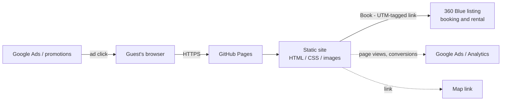

# System Architecture & Technical Stack

> **📋 DOCUMENTATION RULES FOR AI ASSISTANTS**
>
> **Document Type**: Tier 1 Core Document (never archive, update when architecture changes)
> **Purpose**: The map of the system - what the components are, how they connect, and which design doc covers each
> **Update Frequency**: When a component is added, removed or changes its role
>
> **When editing this document**:
> - ✅ Keep it thin: it's a hub. Each component gets a row in "Components" with a link to its design doc in `docs/design/`
> - ✅ Describe the system as it is now, and mark each component's status: 🟢 built · 🟡 partly built · ⚪ designed, not built
> - ✅ Keep the high-level diagram and the technology stack current
> - ❌ Don't write more than one paragraph about a single component - that belongs in its design doc
> - ❌ Don't add implementation details or code-level design (use design docs)
> - ❌ Don't add task tracking or progress (use 03_TODO.md)
> - ❌ Don't describe environments or deployment (use 04_INFRASTRUCTURE.md)
>
> **Full Documentation System**: [docs/00_ONBOARDING.md](00_ONBOARDING.md)

---

## 1. Architecture Principles

1. **Plain HTML and CSS** - No framework and no build step. The only JavaScript is Google's tag. What's in the repo is what's served.
2. **Mobile first** - Most guests look on a phone; the layout starts there.
3. **Fast** - Compressed, self-hosted images and one stylesheet. Google's tag is the only thing loaded from another site.
4. **Every road leads to the listing** - Each booking call to action links to the 360 Blue listing, tagged with its campaign.

---

## 2. High-Level System Architecture

**Key Data Flow:**
An ad or promotion brings the guest to the site. They browse, then click a booking button: Google counts the conversion and the guest lands on the 360 Blue listing to book. A merge to `main` publishes the site.

---

## 3. Components

| Component | What it does | Status | Design doc |
|-----------|--------------|--------|------------|
| Static site | The pages, the stylesheet and the images guests see | ⚪ | Created when the site is built: `docs/design/SITE-DESIGN.md` |

**Status:** 🟢 built · 🟡 partly built · ⚪ designed, not built

New component? Create its design doc from [templates/DESIGN.md](./templates/DESIGN.md) and add a row here.

---

## 4. Technology Stack

| Component | Technology | Purpose |
|-----------|-----------|---------|
| **Markup** | HTML5 | The pages |
| **Styling** | CSS, one stylesheet | Layout and look |
| **Hosting** | GitHub Pages | Serves the site |
| **Measurement** | Google tag - gtag.js | Analytics, and Google Ads conversions on clicks through to the listing |
| **Checks** | Nu HTML Checker, in Docker | Validates the HTML and CSS |

---

## 5. Cross-Cutting Concerns

- **Data storage:** None. Content lives in the HTML files.
- **Security:** No server code and no user data. HTTPS comes from GitHub Pages.
- **External integrations:** Links to the 360 Blue listing and maps; the Google tag for analytics and ad conversions.

---

## 7. Known Limitations

- Every content change is an HTML edit and a merge.
- No contact form: GitHub Pages serves static files only.
- The site counts clicks through to the listing, not bookings: those happen on 360 Blue.

---

## Related Documents

- **[01_PRD.md](./01_PRD.md)** - Product requirements & user needs
- **[03_TODO.md](./03_TODO.md)** - Project status & roadmap
- **[04_INFRASTRUCTURE.md](./04_INFRASTRUCTURE.md)** - Hosting & deployment
- **[05_DESIGN-DECISIONS.md](./05_DESIGN-DECISIONS.md)** - Key decisions
- **[design/](./design/)** - One design doc per component

---

**Last Updated:** 2026-10-10
**Owner:** Andres Garcia
