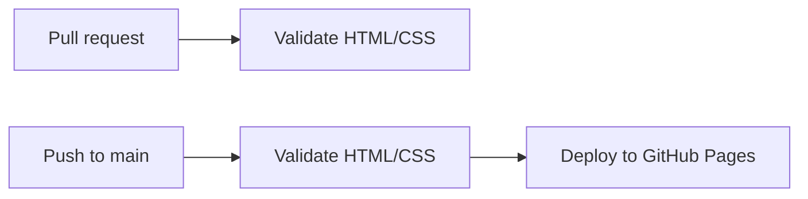

# Infrastructure & Deployment

> **📋 DOCUMENTATION RULES FOR AI ASSISTANTS**
>
> **Document Type**: Tier 1 Core Document (never archive, update when infrastructure changes)
> **Purpose**: The map of environments, cloud services, CI/CD and deployment - with links to the docs that hold the detail
> **Update Frequency**: When infrastructure components or deployment processes change
>
> **When editing this document**:
> - ✅ Keep it thin: it's a hub. Detailed procedures and designs go in `docs/design/` or `docs/guides/`, linked from "Details"
> - ✅ Document environments (local-dev, dev, prod - and staging, if the project has one), cloud services, CI/CD workflows, and secrets
> - ✅ Fill in placeholder sections as infrastructure is defined
> - ❌ Don't write step-by-step procedures here (deploys, promotions, recovery) - put them in a guide and link it
> - ❌ Don't duplicate system architecture (lives in 02_ARCHITECTURE.md)
> - ❌ Don't add task tracking (lives in 03_TODO.md)
>
> **Full Documentation System**: [docs/00_ONBOARDING.md](00_ONBOARDING.md)

---

## Environments

| Environment | Purpose | Infrastructure | Deployment |
|-------------|---------|----------------|------------|
| **local-dev** | Preview while editing | A static file server in Docker | Manual |
| **prod** | The live site | GitHub Pages | Auto, on push to `main` |

There is no separate dev environment: a pull request's checks are the gate, and the site is small enough to preview locally.

### Local Development (local-dev)

The preview and check commands are recorded in the [README](../README.md#-quick-start) once the site exists.

---

## CI/CD

**Platform:** GitHub Actions

### Workflows

Nothing deploys outside these workflows - the rule is in `AGENTS.md`.

| Workflow | Trigger | Action |
|----------|---------|--------|
| Validate | Pull request | Run the HTML/CSS checks |
| Deploy | Push to `main` | Run the checks, then publish to GitHub Pages |

**Workflow files:** `.github/workflows/` - added in Phase 1.3.

---

## Secrets & Environment Variables

None. The deploy workflow uses the repository's built-in `GITHUB_TOKEN` with Pages permissions. The Google tag and Ads conversion IDs are public and live in the pages.

---

## Hosting

- **GitHub Pages**, source "GitHub Actions", on repository `ag-altoviento/oceanbliss-website`
- **URL:** `https://oceanbliss.life`, with `www.oceanbliss.life` redirecting to it. GitHub Pages serves the custom domain and its HTTPS certificate
- **DNS** at the domain's registrar: the apex `oceanbliss.life` has `A` records to `185.199.108.153`, `185.199.109.153`, `185.199.110.153` and `185.199.111.153`, plus the matching `AAAA` records; `www` is a `CNAME` to `ag-altoviento.github.io`
- **Domain verification:** `oceanbliss.life` is verified in the `ag-altoviento` GitHub account's Pages settings, so no other account can claim it
- The custom domain is set in the repository's Pages settings. With the GitHub Actions source, a `CNAME` file in the repository is ignored

---

## Related Documents

- [02_ARCHITECTURE.md](./02_ARCHITECTURE.md) - System design
