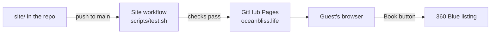

# Static Site Design

> **📋 DOCUMENTATION RULES FOR AI ASSISTANTS**
>
> **Document Type**: Tier 2 Reference Document (never archive; update as the component changes)
> **Purpose**: How Static Site works now - its responsibilities, boundaries, flows and interfaces
> **Update Frequency**: Whenever the component's design changes, before or with the code
>
> **When editing this document**:
> - ✅ One design doc per component. Changes to this component go in this document, as edits to the relevant section
> - ✅ Describe the design as it is now; mark parts not built yet with ⚪
> - ✅ Cite decisions by ID (`DECISION_012`) and link them, instead of restating their reasoning
> - ✅ When the component implements product behaviour, cite the product spec section (`PRODUCT-DESIGN.md §4`) instead of restating its rules
> - ✅ Keep it linked from the Components table in `docs/02_ARCHITECTURE.md` (or "Details" in `04_INFRASTRUCTURE.md`)
> - ❌ Don't start a new document for a ticket, a bug or a mechanism - it's a section here
> - ❌ Don't keep a history of how the design got here - decisions go in `05_DESIGN-DECISIONS.md`, work logs in session docs
> - ❌ Don't track tasks here (use `03_TODO.md` and the session doc)
>
> **Full Documentation System**: [docs/00_ONBOARDING.md](../00_ONBOARDING.md)

**Status:** 🟡 partly built - live once Pages and DNS are set up; the Google tag is ⚪
**Owner:** ag-altoviento · **Last Updated:** 2026-10-11
**Implements:** None - the product is described in [01_PRD.md](../01_PRD.md)

---

## Purpose

The Ocean Bliss marketing site at https://oceanbliss.life: one page that sells the house to guests arriving from the owner's ads and promotions, and sends them to the 360 Blue listing to book.

## Responsibilities

**Responsible for:**
- Presenting the house - photos, rooms, amenities, location
- Sending every booking intent to the listing, tagged with where on the site it came from

**Not responsible for** (and who is):
- Availability, prices, bookings, guest services - 360 Blue, on the listing ([DECISION_002](../05_DESIGN-DECISIONS.md#decision-002))

## How It Works

- **Files:** everything served lives in `site/`: `index.html`, `css/style.css` and `images/`. Nothing outside `site/` is published.
- **Page:** one page with sections Home/hero, facts, The house, Photos, Location and Plan your stay; the header links jump to them.
- **Photos:** a selection from the listing gallery, used with 360 Blue's permission. Each comes in two sizes: `<name>.jpg`, the full photo at most 1600px and about 300 KB, and `<name>-sm.jpg`, 800px for the grid. A gallery thumbnail links to the full photo.
- **Booking links:** three placements - header, hero, book-section - each a link to the listing with `utm_source=oceanbliss.life`, `utm_medium=referral`, `utm_campaign=website` and `utm_content=<placement>`.
- **Measurement** ⚪: the Google tag, counting a click on a booking link as a Google Ads conversion.

## Interfaces

| Interface | Type | Notes |
|-----------|------|-------|
| 360 Blue listing | Outbound link | The only booking path; URL in the three booking buttons |
| Google Maps | Outbound link | Address search in Location |
| `scripts/test.sh` | Check | Nu HTML Checker for HTML and CSS, then lychee for internal links and images, both in Docker; run by CI and locally |
| `scripts/preview.sh` | Local preview | nginx in Docker serving `site/` at http://localhost:8080 |
| `.github/workflows/pages.yml` | CI/CD | Checks every PR; on push to `main`, checks and publishes `site/` |

## Data

None beyond the files in `site/`.

## Key decisions

- [DECISION_001](../05_DESIGN-DECISIONS.md#decision-001) - plain HTML and CSS, no site generator
- [DECISION_002](../05_DESIGN-DECISIONS.md#decision-002) - bookings stay on 360 Blue

## Known Traps

- The link check runs offline, so it doesn't notice if 360 Blue changes the listing URL. Click a booking button after any change on their side.
- Headless Chrome won't render narrower than 500px, so a 390px screenshot shows the page cut off when it isn't. Check phone layouts in the browser's device mode.

## Related

- [02_ARCHITECTURE.md](../02_ARCHITECTURE.md) · [04_INFRASTRUCTURE.md](../04_INFRASTRUCTURE.md)
