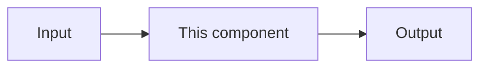

# [COMPONENT] Design

> **📋 DOCUMENTATION RULES FOR AI ASSISTANTS**
>
> **Document Type**: Tier 2 Reference Document (never archive; update as the component changes)
> **Purpose**: How [COMPONENT] works now - its responsibilities, boundaries, flows and interfaces
> **Update Frequency**: Whenever the component's design changes, before or with the code
>
> **When editing this document**:
> - ✅ One design doc per component. Changes to this component go in this document, as edits to the relevant section
> - ✅ Describe the design as it is now; mark parts not built yet with ⚪
> - ✅ Cite decisions by ID (`DECISION_012`) and link them, instead of restating their reasoning
> - ✅ When the component implements product behaviour, cite the product spec section (`PRODUCT-DESIGN.md §4`) instead of restating its rules
> - ✅ Keep it linked from the Components table in `docs/02_ARCHITECTURE.md` (or "Details" in `04_INFRASTRUCTURE.md`)
> - ❌ Don't start a new document for a ticket, a bug or a mechanism - it's a section here
> - ❌ Don't keep a history of how the design got here - decisions go in `05_DESIGN-DECISIONS.md`, work logs in session docs
> - ❌ Don't track tasks here (use `03_TODO.md` and the session doc)
>
> **Full Documentation System**: [docs/00_ONBOARDING.md](../00_ONBOARDING.md)

**Status:** 🟢 built · 🟡 partly built · ⚪ designed, not built
**Owner:** [NAME] · **Last Updated:** [DATE]
**Implements:** [PRODUCT-DESIGN.md §n, or "None"]

---

## Purpose

[One or two sentences: what this component is for, and who or what uses it.]

## Responsibilities

**Responsible for:**
- [RESPONSIBILITY]

**Not responsible for** (and who is):
- [NON_RESPONSIBILITY] - handled by [OTHER_COMPONENT]

## How It Works

[A diagram of the main flow, then a short explanation of each step. For an LLM product, say where each behaviour lives: a rule in code, a field a model outputs, or judgment in a prompt, which needs evals.]

## Interfaces

| Interface | Type | Notes |
|-----------|------|-------|
| [NAME] | API / event / queue / table | [What it carries, who calls it] |

## Data

[The data this component owns: tables, buckets, caches - and what each holds.]

## Key decisions

Only the decisions in `05_DESIGN-DECISIONS.md` that shape this component. Product rules it follows are cited by spec section, not listed here.

- DECISION_XXX - [one line]. Link it as `[DECISION_XXX](../05_DESIGN-DECISIONS.md#decision-xxx)`.

## Known Traps

[Things that fail silently or read the wrong way - link the matching entries in `10_TROUBLESHOOTING.md`.]

## Related

- [OTHER_DESIGN_DOC]
